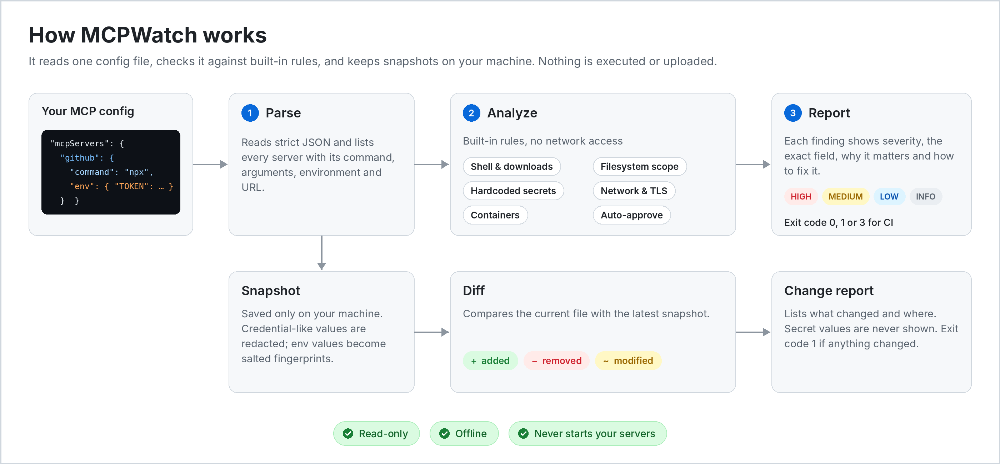
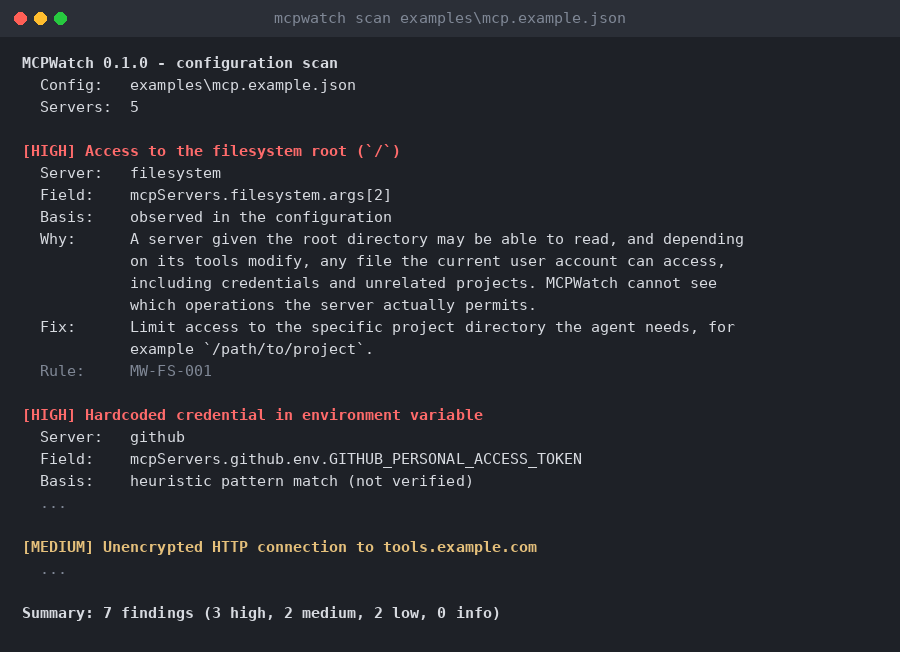

# MCPWatch

[](https://github.com/hasheramin5-cyber/MCPWatch/actions/workflows/ci.yml)
[](https://github.com/hasheramin5-cyber/MCPWatch/releases)
[](#license)


**Know what your AI agents can access.**

MCPWatch is a small command-line tool that statically audits local [Model Context Protocol](https://modelcontextprotocol.io) (MCP) configuration files and flags risky settings *before* you connect them to an AI coding agent. It also keeps local snapshots so you can see exactly what changed in a configuration over time.

MCPWatch only reads the configuration file you point it at. It never starts your MCP servers, never runs the commands it finds, and never sends data over a network.

## The problem

An MCP configuration decides which programs your AI agent launches, which folders they can reach, and which credentials they receive. Those files are easy to copy from a README, share in a repository, or edit by hand, and a single line such as a filesystem root, a pasted API token or a `curl | sh` launcher can quietly widen what an agent can do. MCPWatch gives you a quick, readable review of those settings and a way to notice when they change.

## Features

- **Configuration scanner** for strict JSON files using the common layouts: `mcpServers` (Claude Desktop, Cursor, Windsurf, project `.mcp.json`), `servers` (VS Code `mcp.json`), `mcp.servers` (VS Code `settings.json`) and `context_servers` (Zed).
- **Findings with context**: severity (HIGH, MEDIUM, LOW, INFO), the exact configuration field, why it matters, and how to fix it. Each finding states whether it was *observed* directly or is a *heuristic* match.
- **Checks** for shell launchers and download-and-execute patterns, unpinned `npx`/`uvx` packages, overly broad filesystem paths (root, home, credential folders, system directories, container sockets), risky Docker options, hardcoded secrets, plain-HTTP and all-interface network settings, disabled certificate verification, and auto-approved tools.
- **Secrets are never printed.** Findings name the field, not the value.
- **Local snapshots and diffs** that report added, removed and modified servers, including changes to commands, arguments, environment variable names, headers, URLs and other settings.
- **CI-friendly exit codes** and plain output when colors are unavailable.

## Installation

Requires a stable Rust toolchain (1.74 or newer).

```sh
git clone https://github.com/hasheramin5-cyber/MCPWatch.git
cd MCPWatch
cargo build --release
# binary: target/release/mcpwatch (mcpwatch.exe on Windows)

# or install it into ~/.cargo/bin
cargo install --path .
```

## How it works



## Usage

```sh
mcpwatch scan <config-path>        # analyze a configuration
mcpwatch snapshot <config-path>    # save a local snapshot
mcpwatch diff <config-path>        # compare with the latest snapshot
mcpwatch --help
mcpwatch --version
```

Examples:

```sh
mcpwatch scan examples/mcp.example.json
mcpwatch scan ~/.cursor/mcp.json --fail-on medium
mcpwatch snapshot .vscode/mcp.json
mcpwatch diff .vscode/mcp.json
mcpwatch snapshot mcp.json --snapshot-dir ./my-snapshots
```

Options:

| Option | Applies to | Description |
| --- | --- | --- |
| `--fail-on <high\|medium\|low\|info\|never>` | `scan` | Lowest severity that produces exit status 1. Default: `high`. |
| `--snapshot-dir <DIR>` | `snapshot`, `diff` | Where snapshots live. Also settable with `MCPWATCH_HOME`. |
| `--no-color` | all | Disable colors. `NO_COLOR` is also honored. |

### Exit codes

| Code | Meaning |
| --- | --- |
| `0` | Success: no findings at or above the threshold (`scan`), or no changes (`diff`), or a snapshot was saved. |
| `1` | Findings at or above `--fail-on` (`scan`), or changes detected (`diff`). |
| `2` | Invalid command-line usage. |
| `3` | Runtime error: unreadable or invalid configuration, missing snapshot, snapshot I/O failure. |

### Snapshots

Snapshots are stored in a per-user local data directory by default (`$XDG_DATA_HOME/mcpwatch/snapshots` or `~/.local/share/mcpwatch/snapshots` on Linux, `~/Library/Application Support/mcpwatch/snapshots` on macOS, `%LOCALAPPDATA%\mcpwatch\snapshots` on Windows). Each `snapshot` run adds a new file; `diff` compares against the newest one for that configuration path. Moving or renaming the configuration file means it is treated as a different configuration.

To reduce accidental exposure:

- Environment variable and header **values are not stored**; only salted, truncated SHA-256 fingerprints are kept, so changes are detected but values are not shown.
- Arguments, URLs and other settings that look like credentials are replaced with `<redacted>`. Other arguments (such as paths) are stored as written.
- On Unix the snapshot directory is created with mode `0700` and files with mode `0600`. On Windows, files inherit the permissions of the directory; MCPWatch does not change ACLs.

Fingerprints of low-entropy values (short passwords, for example) can be guessed by brute force by someone who has the file, because the salt is stored alongside them. Treat snapshot files as sensitive and keep them out of version control.

## Example report



Output from `mcpwatch scan examples/mcp.example.json`, abridged to two of the seven findings:

```text
MCPWatch 0.1.0 - configuration scan
  Config:  examples/mcp.example.json
  Servers: 5

[HIGH] Access to the filesystem root (`/`)
  Server:  filesystem
  Field:   mcpServers.filesystem.args[2]
  Basis:   observed in the configuration
  Why:     A server given the root directory may be able to read, and
           depending on its tools modify, any file the current user account
           can access, including credentials and unrelated projects. ...
  Fix:     Limit access to the specific project directory the agent needs,
           for example `/path/to/project`.
  Rule:    MW-FS-001

[HIGH] Hardcoded credential in environment variable
  Server:  github
  Field:   mcpServers.github.env.GITHUB_PERSONAL_ACCESS_TOKEN
  Basis:   heuristic pattern match (not verified)
  ...

Summary: 7 findings (3 high, 2 medium, 2 low, 0 info)
```

For a configuration with nothing to report:

```text
[OK] No findings in 1 server. None of MCPWatch's built-in checks matched; this is not a guarantee that the configuration is safe.
```

## Sample configuration

[`examples/mcp.example.json`](examples/mcp.example.json) is a deliberately imperfect configuration used for the report above. The token in it is a made-up placeholder, not a real credential. A minimal configuration looks like this:

```json
{
  "mcpServers": {
    "filesystem": {
      "command": "npx",
      "args": ["-y", "@modelcontextprotocol/server-filesystem@2025.1.14", "/home/alice/project"]
    }
  }
}
```

## Security limitations

MCPWatch is an aid for review, not a guarantee.

- **Static analysis only.** It reads one JSON file. It does not run, inspect or test the MCP servers, the packages they download, or the services they connect to, so it cannot tell you whether a server is actually safe.
- **Indicators, not confirmed vulnerabilities.** Findings are pattern matches. Some will be false positives (for example an intentional wrapper script) and some risks will be missed (for example an obfuscated command, a malicious package with a harmless name, or a secret in an unusual format).
- **Limited view of access.** MCPWatch cannot see which operations a server permits, what a client enforces, or what the operating system restricts. A path such as `/` is reported because it *may* grant broad access.
- **Heuristic secret detection.** Secrets are recognized by well-known token formats and credential-like names. Values are never verified or printed.
- **Client behavior varies.** Settings such as `autoApprove` or `trust` are client-specific and may be ignored or interpreted differently.
- **Strict JSON only.** Files with comments or trailing commas (JSONC) are rejected; remove them first.
- **No remediation.** MCPWatch never edits your configuration.

Do not rely on MCPWatch as your only control. Review the servers you install, keep them updated, grant the least access needed, and use your client's confirmation prompts.

## Development

```sh
cargo fmt
cargo clippy --all-targets
cargo test
```

## Contributing

Issues and pull requests are welcome. Please keep changes small and focused, add tests for new rules (including a case that should *not* trigger, to guard against false positives), and make sure `cargo fmt`, `cargo clippy` and `cargo test` pass. Rules must never copy secret values into their output, and the tool must stay offline and must not execute anything from the files it scans. For security-sensitive reports, please contact the maintainers privately instead of opening a public issue.

## License

Licensed under either of

- Apache License, Version 2.0 ([LICENSE-APACHE](LICENSE-APACHE))
- MIT license ([LICENSE-MIT](LICENSE-MIT))

at your option.

Unless you explicitly state otherwise, any contribution intentionally submitted for inclusion in this project by you shall be dual licensed as above, without any additional terms or conditions.
